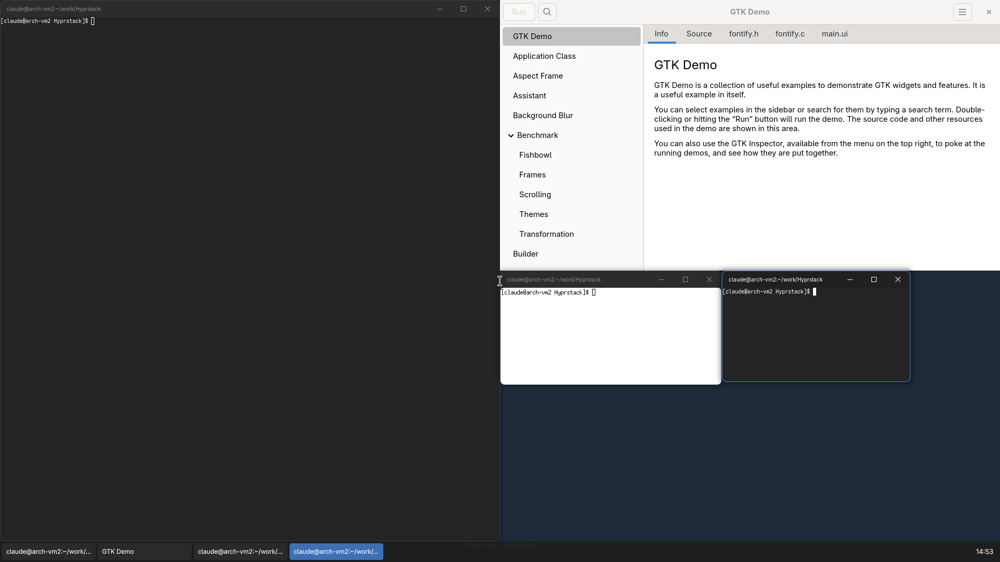

# Hyprstack

Fork Hyprlanda do pracy w trybie **stacking** (okna pływające jak w KDE / Windows) zamiast tilingu.
Drop-in zamiennik: ta sama binarka `Hyprland`, `hyprctl`, IPC i config w Lua — więc Quickshell
(moduł Hyprland) działa bez zmian.

Projekt, decyzje i stan prac: [DESIGN.md](DESIGN.md). Instalacja na czystym Archu: `scripts/hyprstack/setup-arch.sh`, kontekst dla Claude: [HANDOFF.md](HANDOFF.md).

## Co działa

| | |
|---|---|
| Okna | Wszystkie pływające, rozmieszczanie smart/center/cascade/mouse, dialogi nad rodzicem i wyśrodkowane |
| Belki tytułowe | Rysowane przez kompozytor dla okien SSD (Qt, foot, X11…): tytuł, minimalizuj/maksymalizuj/zamknij, dwuklik, przeciąganie |
| Okna CSD (GTK, Chromium…) | Własne dekoracje i cienie wyświetlane poprawnie, bez podwójnej ramki |
| Maximize / minimize | Prawdziwe (wiele zmaksymalizowanych naraz, restore geometrii, przeciągnięcie przywraca rozmiar) |
| Quick-tile | Krawędź → połowa, róg → ćwiartka, góra → maximize, z podglądem; tylko zewnętrzne krawędzie monitorów |
| Klawiatura | Win+←→↑↓, Win+Shift+←→ (na inny monitor), Win+D, Alt+F4, Alt+Tab (przez shell) |
| Z-order | Klik/fokus wynosi okno, keep-above / keep-below |
| Shell | foreign-toplevel z minimize/maximize, MRU, miniatury (też zminimalizowanych), eventy IPC |

## Config

Nowy użytkownik dostaje `example/hyprstack.lua`. Opcje specyficzne dla forka (`hl.config({ stacking = { ... } })`):

| Opcja | Domyślnie | Opis |
|---|---|---|
| `stacking.placement` | `smart` | `smart` / `center` / `cascade` / `mouse` |
| `stacking.center_transients` | `true` | dialogi wyśrodkowane nad rodzicem |
| `stacking.cascade_offset` | `32` | przesunięcie kaskady |
| `stacking.raise_on_focus` | `true` | fokus z klawiatury/aktywacji wynosi okno |
| `stacking.clamp_new_to_workarea` | `true` | zbyt duże nowe okna są zmniejszane |
| `stacking.decorate_csd` | `false` | ramka/cień/zaokrąglenia także dla okien CSD |
| `stacking.remember_geometry` | `all` | zapamiętywanie geometrii okien per aplikacja: `none` / `size` / `all` (rozmiar i pozycja na tym samym monitorze) |
| `stacking.remember_geometry_file` | `""` | plik pamięci (domyślnie `$XDG_STATE_HOME/hyprstack/window-geometry`) |
| `stacking.minimize_animation` | `true` | minimalizacja zwija okno do przycisku na taskbarze (`set_rectangle` z foreign-toplevel) |
| `stacking.window_menu` | `true` | informuje klientów, że jest menu okna (rysuje je shell, event `windowmenu`) |
| `stacking.titlebar.*` | | `enabled`, `height`, `font_family`, `font_size`, `text_align`, `padding`, `buttons`, `button_width`, `double_click`, kolory `col.*` |
| `stacking.quick_tile.*` | | `enabled`, `edge_threshold`, `corner_size`, `top_action` (`maximize`/`tile`/`none`), `col.preview`, `col.preview_border` |

Tiling nadal istnieje (`general.layout = "dwindle"` itd.), ale nie jest rozwijany ani wspierany w tym forku.

## Dispatchery

| Dispatcher | |
|---|---|
| `hl.dsp.window.minimize({ action, window })` | `action`: `enable` (domyślnie) / `disable` / `toggle` |
| `hl.dsp.window.maximize({ action, mode, window })` | `mode`: `full` / `horizontal` / `vertical` |
| `hl.dsp.window.tile({ edges, window })` | `left`, `right`, `top`, `bottom`, `top_left`, …, `none` |
| `hl.dsp.window.snap({ direction, window })` | semantyka Win+strzałki |
| `hl.dsp.window.move_to_monitor({ direction, window })` | z zachowaniem pozycji i stanu |
| `hl.dsp.window.keep_above({ action, window })`, `keep_below` | warstwy |
| `hl.dsp.show_desktop()` | Win+D |
| `hl.dsp.window.menu({ window })` | menu okna (Alt+Spacja) — event `windowmenu` dla shella |

## IPC dla shella

- `hyprctl clients -j`: `minimized`, `maximized` (0 / 1 = poziomo / 2 = pionowo / 3 = pełny), `tiled`
  (bitmaska 1 = lewo, 2 = prawo, 4 = góra, 8 = dół), `stackLayer` (0 / 1 / 2), `focusHistoryID` (MRU).
- socket2: `minimized>>ADDR,0|1`, `maximized>>ADDR,MODE`, `tiled>>ADDR,EDGES`, `stacklayer>>ADDR,LAYER`,
  `showdesktop>>0|1`, `windowmenu>>ADDR,X,Y` (prawy klik na belce, Alt+Spacja, `show_window_menu`
  od aplikacji → menu okna rysuje shell).

## Uruchomienie na prawdziwym ekranie (VM / sprzęt)

1. Build i instalacja do `/usr/local` (przed paczkowym Hyprlandem w `PATH`):
   `cmake --build build && sudo cmake --install build` — po każdej zmianie kodu.
2. Config: `~/.config/hypr/hyprland.lua` (np. kopia `example/hyprstack.lua`). **Build Debug czyta
   `hyprlandd.lua`** (z "d") — najprościej `ln -s hyprland.lua ~/.config/hypr/hyprlandd.lua`.
3. Start z tty: `start-hyprland --path /usr/local/bin/Hyprland`.

Na VM jest to ustawione na stałe: autologin na tty1 (`/etc/systemd/system/getty@tty1.service.d/autologin.conf`)
i start kompozytora z `~/.bash_profile`, roboczy shell startuje z configu (`hl.on("hyprland.start", ...)`).
Restart sesji: `hyprctl dispatch 'hl.dsp.exit()'` (autologin uruchomi ją ponownie). Uwaga: sesja na
ekranie VM trzyma kartę DRM, więc testy headless (`run-hyprtester`, `hs-session`) wymagają jej zatrzymania
(`sudo systemctl stop getty@tty1`, potem `sudo systemctl start getty@tty1`).

## Rozwój

- Build: `cmake -G Ninja -DCMAKE_BUILD_TYPE=Debug -DTESTS=true -S . -B build && cmake --build build`
- Sesja do ręcznego klikania: `scripts/e2e/hs-session start --default-config --res 1920x1080 --vnc 5900 --shell`,
  potem `ssh -L 5900:127.0.0.1:5900 claude@<vm>` i klient VNC na `localhost:5900`.
- Sesja testowa headless: `scripts/e2e/hs-session start [--vnc 5900] [--shell] [--plugin]`, potem
  `spawn`, `exec`, `ctl`, `shot`, `stop`. Podgląd przez VNC: `ssh -L 5900:127.0.0.1:5900 <vm>`.
- Testy: `STACK_ONLY=1 scripts/e2e/run-hyprtester` (grupa `stack`) albo nazwy testów jako argumenty.
- Roboczy shell (taskbar + Alt+Tab): `scripts/e2e/dev-shell/`.
- Synchronizacja z upstreamem: `scripts/hyprstack/sync-upstream.sh`.
